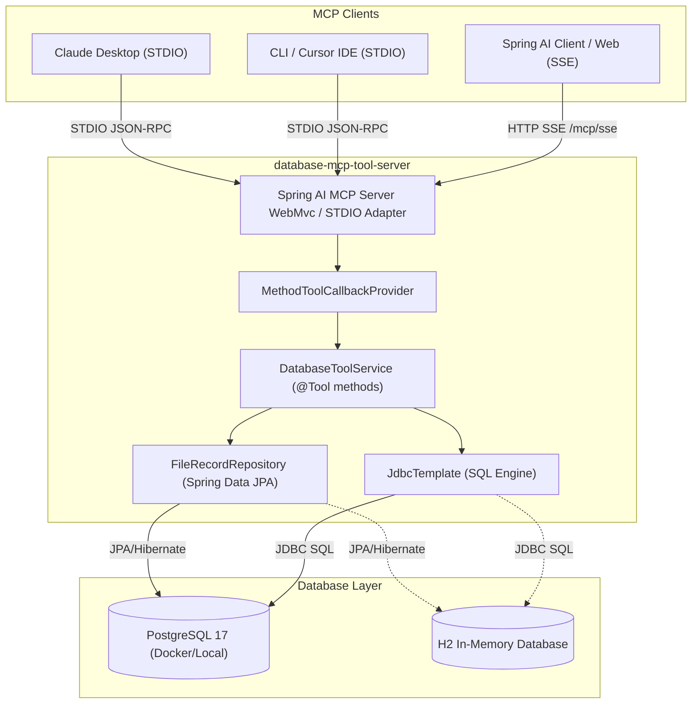

# Database MCP Tool Server

[](https://openjdk.org/)
[](https://spring.io/projects/spring-boot)
[](https://spring.io/projects/spring-ai)
[](https://modelcontextprotocol.io/)
[](https://www.postgresql.org/)
[](https://www.h2database.com/)
[](LICENSE)

A high-performance **Model Context Protocol (MCP)** server built with **Spring Boot 3.4.1** and **Spring AI**. This server provides AI agents and Large Language Models (LLMs) with safe, structured, and persistent access to relational database storage (PostgreSQL and in-memory H2), file record tracking, and dynamic SQL query execution.

Supporting both **STDIO** (standard input/output for local desktop clients) and **SSE** (Server-Sent Events over HTTP for distributed web clients), this server is designed to work seamlessly with **Claude Desktop**, **Cursor**, **Spring AI MCP Clients**, and custom LLM workflows.

---

## Table of Contents

- [Overview](#overview)
- [Architecture](#architecture)
- [Key Features](#key-features)
- [MCP Tool Catalog](#mcp-tool-catalog)
  - [`save_file_record`](#1-save_file_record)
  - [`get_file_records`](#2-get_file_records)
  - [`execute_sql`](#3-execute_sql)
- [Supported Transports](#supported-transports)
  - [STDIO Transport (Local Desktop / CLI)](#stdio-transport-local-desktop--cli)
  - [SSE Transport (HTTP / Web Clients)](#sse-transport-http--web-clients)
- [Tech Stack](#tech-stack)
- [Project Structure](#project-structure)
- [Prerequisites](#prerequisites)
- [Getting Started](#getting-started)
  - [1. Build Application](#1-build-application)
  - [2. Database Setup](#2-database-setup)
  - [3. Running the Server](#3-running-the-server)
- [Client Integration Guides](#client-integration-guides)
  - [Claude Desktop](#claude-desktop)
  - [Spring AI MCP Client](#spring-ai-mcp-client)
  - [Cursor / IDE Integration](#cursor--ide-integration)
  - [MCP Inspector (Interactive Testing)](#mcp-inspector-interactive-testing)
- [Database Schema](#database-schema)
- [Configuration Reference](#configuration-reference)
- [Troubleshooting](#troubleshooting)

---

## Overview

Anthropic's **Model Context Protocol (MCP)** enables AI systems to interact with external tools and data sources via standardized JSON-RPC 2.0 communication. 

The **Database MCP Tool Server** bridges AI applications and relational databases by:
1. Exposing domain-specific database tools annotated with Spring AI's `@Tool` abstraction.
2. Managing file tracking records with structured metadata and summaries.
3. Allowing LLMs to safely query, inspect, and update tables using structured SQL execution.
4. Preserving protocol integrity during STDIO mode by redirecting application logging to `STDERR`.

```
+-------------------------------------------------------+
|                 AI Client / Host                      |
| (Claude Desktop, Cursor, Spring AI Client, etc.)     |
+-------------------------------------------------------+
                           |
               JSON-RPC 2.0 (STDIO / SSE)
                           |
                           v
+-------------------------------------------------------+
|              Database MCP Tool Server                 |
|       (Spring Boot 3.4.1 + Spring AI MCP)            |
|                                                       |
|  [ save_file_record ] [ get_file_records ] [ execute_sql ]
+-------------------------------------------------------+
              |                                 |
              v                                 v
+---------------------------+       +---------------------------+
|   PostgreSQL Database     |  OR   |     H2 In-Memory DB       |
|  (Default / Production)   |       | (Zero-setup Dev / Test)   |
+---------------------------+       +---------------------------+
```

---

## Architecture

### Component Diagram



---

## Key Features

- **Standardized MCP Tool Registry**: Uses Spring AI's `MethodToolCallbackProvider` and `@Tool` annotations to register methods dynamically with full input validation and schema generation.
- **Dual Transport Flexibility**:
  - **STDIO**: High-speed pipe communication without opening external network ports.
  - **SSE (Server-Sent Events)**: Web-native streaming over HTTP on port `9091` (`/mcp/sse` and `/mcp/message`).
- **Clean STDIO Stream Isolation**: Logback is pre-configured via `logback-spring.xml` to route logs exclusively to `System.err`, ensuring standard output (`System.out`) remains 100% clean JSON-RPC for MCP clients.
- **Pluggable Persistence**:
  - **PostgreSQL 17**: Default production persistence with Docker Compose orchestration.
  - **H2 In-Memory**: Instant zero-dependency development/testing using `--spring.profiles.active=h2`.
- **Intelligent SQL Routing**: The `execute_sql` tool detects whether a query is a read operation (`SELECT`, `WITH`, `SHOW`) or a mutation (`INSERT`, `UPDATE`, `DELETE`, `CREATE`), returning structured records or row count impact accordingly.
- **Automatic Schema Maintenance**: Hibernate DDL generation automatically ensures the `file_records` table and indices exist on startup.

---

## MCP Tool Catalog

The server exposes three core MCP tools to connected AI models:

### 1. `save_file_record`

Persists file metadata, optional content summary, and processing status into the database. If the file exists on the host filesystem, its file size is automatically computed.

- **Tool Name**: `save_file_record`
- **Method**: [DatabaseToolService.saveFileRecord()](file:///Users/rajesh/IdeaProjects/database-mcp-tool/src/main/java/com/database/mcp/tool/service/DatabaseToolService.java#L30-L59)
- **Parameters**:

| Parameter | Type | Required | Description |
|---|---|---|---|
| `filePath` | `string` | **Yes** | Absolute or relative path of the file to record |
| `contentSummary` | `string` | No | Short summary or description of the file contents |
| `status` | `string` | No | Processing status (e.g. `'PROCESSED'`, `'SUCCESS'`, `'SAVED'`, `'ERROR'`). Defaults to `'SAVED'` |
| `metadataJson` | `string` | No | Custom JSON formatted metadata or key-value attributes |

- **Sample Request (JSON-RPC tool call)**:
```json
{
  "name": "save_file_record",
  "arguments": {
    "filePath": "/workspace/data/sales_q3.csv",
    "contentSummary": "Quarterly sales figures for EMEA region with 14,000 line items.",
    "status": "PROCESSED",
    "metadataJson": "{\"rows\": 14000, \"region\": \"EMEA\", \"department\": \"Finance\"}"
  }
}
```

- **Sample Response**:
```json
{
  "id": 1,
  "filePath": "/workspace/data/sales_q3.csv",
  "fileName": "sales_q3.csv",
  "fileSize": 1048576,
  "status": "PROCESSED",
  "contentSummary": "Quarterly sales figures for EMEA region with 14,000 line items.",
  "metadataJson": "{\"rows\": 14000, \"region\": \"EMEA\", \"department\": \"Finance\"}",
  "createdAt": "2026-10-15T14:30:00"
}
```

---

### 2. `get_file_records`

Retrieves saved file records from the database with optional filtering by status or keyword search against file names.

- **Tool Name**: `get_file_records`
- **Method**: [DatabaseToolService.getFileRecords()](file:///Users/rajesh/IdeaProjects/database-mcp-tool/src/main/java/com/database/mcp/tool/service/DatabaseToolService.java#L61-L75)
- **Parameters**:

| Parameter | Type | Required | Description |
|---|---|---|---|
| `statusFilter` | `string` | No | Filter records by exact status (case-insensitive, e.g. `'SUCCESS'`, `'PROCESSED'`) |
| `searchKeyword` | `string` | No | Substring match against `fileName` (case-insensitive) |

> **Note**: If neither parameter is specified, all file records are returned.

- **Sample Request**:
```json
{
  "name": "get_file_records",
  "arguments": {
    "searchKeyword": "sales"
  }
}
```

- **Sample Response**:
```json
[
  {
    "id": 1,
    "filePath": "/workspace/data/sales_q3.csv",
    "fileName": "sales_q3.csv",
    "fileSize": 1048576,
    "status": "PROCESSED",
    "contentSummary": "Quarterly sales figures for EMEA region with 14,000 line items.",
    "metadataJson": "{\"rows\": 14000, \"region\": \"EMEA\", \"department\": \"Finance\"}",
    "createdAt": "2026-10-15T14:30:00"
  }
]
```

---

### 3. `execute_sql`

Executes custom SQL commands on the underlying database.
- **Read queries** (`SELECT`, `WITH`, `SHOW`): Evaluated via `JdbcTemplate.queryForList()`, returning column-mapped rows in the `data` list.
- **Mutations / DDL** (`INSERT`, `UPDATE`, `DELETE`, `CREATE TABLE`, etc.): Evaluated via `JdbcTemplate.update()`, returning the number of `rowsAffected`.
- **Error handling**: SQL errors are captured and returned safely inside `errorMessage` without crashing the server.

- **Tool Name**: `execute_sql`
- **Method**: [DatabaseToolService.executeSql()](file:///Users/rajesh/IdeaProjects/database-mcp-tool/src/main/java/com/database/mcp/tool/service/DatabaseToolService.java#L77-L95)
- **Parameters**:

| Parameter | Type | Required | Description |
|---|---|---|---|
| `sqlQuery` | `string` | **Yes** | SQL statement to execute |

- **Sample SELECT Request**:
```json
{
  "name": "execute_sql",
  "arguments": {
    "sqlQuery": "SELECT id, file_name, status, file_size FROM file_records WHERE status = 'PROCESSED' ORDER BY id DESC LIMIT 5"
  }
}
```

- **Sample SELECT Response**:
```json
{
  "success": true,
  "sql": "SELECT id, file_name, status, file_size FROM file_records WHERE status = 'PROCESSED' ORDER BY id DESC LIMIT 5",
  "rowsAffected": 1,
  "data": [
    {
      "id": 1,
      "file_name": "sales_q3.csv",
      "status": "PROCESSED",
      "file_size": 1048576
    }
  ],
  "errorMessage": null
}
```

- **Sample DDL / UPDATE Request**:
```json
{
  "name": "execute_sql",
  "arguments": {
    "sqlQuery": "UPDATE file_records SET status = 'ARCHIVED' WHERE id = 1"
  }
}
```

- **Sample UPDATE Response**:
```json
{
  "success": true,
  "sql": "UPDATE file_records SET status = 'ARCHIVED' WHERE id = 1",
  "rowsAffected": 1,
  "data": [],
  "errorMessage": null
}
```

---

## Supported Transports

### STDIO Transport (Local Desktop / CLI)

In STDIO mode, the client spawns the Java process directly and communicates using JSON-RPC messages via standard input and standard output.

```
Client Process (Claude / Cursor)
     |
     |--- (stdin)  JSON-RPC request  ---> [ Spring AI MCP Server ]
     |<-- (stdout) JSON-RPC response <---
     |
     |<-- (stderr) Logging & Diags   <--- [ Logback STDERR Appender ]
```

- Activate using the profile: `--spring.profiles.active=stdio` (or `stdio,h2`).
- Banner mode is disabled (`spring.main.banner-mode=off`).
- Logging is directed to `System.err` and `logs/files-postgre-mcp.log` to prevent corrupting the JSON-RPC pipe.

### SSE Transport (HTTP / Web Clients)

In SSE mode, the application runs as a standard Spring WebMvc server listening on HTTP port `9091`. Clients connect using HTTP Server-Sent Events to stream responses and send mutations via POST.

- Default endpoints:
  - **SSE Endpoint**: `GET http://localhost:9091/mcp/sse`
  - **Message Endpoint**: `POST http://localhost:9091/mcp/message`

---

## Tech Stack

| Component | Technology | Version |
|---|---|---|
| **Runtime** | Java OpenJDK | 17+ (Tested on Java 17 & 27) |
| **Framework** | Spring Boot | `3.4.1` |
| **AI / Protocol** | Spring AI (`spring-ai-starter-mcp-server-webmvc`) | `1.1.0-M1-PLATFORM-2` |
| **Protocol Spec** | Anthropic Model Context Protocol (MCP) | JSON-RPC 2.0 |
| **ORM / Data** | Spring Data JPA / Hibernate | 6.x |
| **Database** | PostgreSQL | 17-alpine |
| **Embedded DB** | H2 Database | 2.x |
| **Containerization** | Docker Compose | Compose V2 |
| **Build Tool** | Apache Maven | 3.9+ |

---

## Project Structure

```
database-mcp-tool/
├── compose.yml                               # PostgreSQL 17 Docker Compose file
├── db.sql                                    # Database initialization DDL script
├── logback-spring.xml                        # STDERR logging configuration for STDIO safety
├── pom.xml                                   # Maven dependencies & Spring AI BOM configuration
├── src/
│   ├── main/
│   │   ├── java/com/database/mcp/tool/
│   │   │   ├── McpApplication.java           # Spring Boot application entry point
│   │   │   ├── config/
│   │   │   │   └── McpToolConfig.java        # ToolCallbackProvider bean registration
│   │   │   ├── dto/
│   │   │   │   ├── FileInfoDto.java          # File metadata data transfer object
│   │   │   │   ├── FileOperationResultDto.java# Operation status wrapper
│   │   │   │   └── QueryResultDto.java       # Structured SQL execution result
│   │   │   ├── entity/
│   │   │   │   └── FileRecordEntity.java     # JPA entity for `file_records` table
│   │   │   ├── repository/
│   │   │   │   └── FileRecordRepository.java # Spring Data JPA repository
│   │   │   └── service/
│   │   │       └── DatabaseToolService.java  # @Tool annotated MCP methods
│   │   └── resources/
│   │       ├── application.properties        # Default configuration (PostgreSQL + SSE)
│   │       ├── application-h2.properties     # In-memory H2 profile configuration
│   │       ├── application-stdio.properties  # STDIO mode & log suppression settings
│   │       ├── claude_desktop_config.json    # Example configuration for Claude Desktop
│   │       └── mcp.json                      # Example configuration for Spring AI Client
│   └── test/
│       └── java/com/database/mcp/tool/
│           └── FilesPostgreMcpApplicationTests.java # Integration test suite
└── target/
    └── database-mcp-tool-server-1.0.0-SNAPSHOT.jar # Packaged executable JAR
```

---

## Prerequisites

1. **Java JDK**: Version 17 or higher installed (`java -version`).
2. **Maven**: Version 3.8+ (or use IDE Maven runner).
3. **Docker & Docker Compose**: Required if running PostgreSQL locally (`docker compose version`).

---

## Getting Started

### 1. Build Application

Package the executable Spring Boot JAR:

```bash
mvn clean package -DskipTests
```

This generates `target/database-mcp-tool-server-1.0.0-SNAPSHOT.jar`.

---

### 2. Database Setup

#### Option A: PostgreSQL with Docker Compose (Recommended for Production)

Start the PostgreSQL 17 container defined in [compose.yml](file:///Users/rajesh/IdeaProjects/database-mcp-tool/compose.yml):

```bash
docker compose up -d
```

- **Host**: `localhost`
- **Port**: `5432`
- **Database**: `mcpdb`
- **Username**: `postgres`
- **Password**: `postgres`

The schema is automatically initialized via [db.sql](file:///Users/rajesh/IdeaProjects/database-mcp-tool/db.sql) and maintained by Hibernate.

#### Option B: In-Memory H2 (Zero-Setup Development)

No Docker or external database installation is needed. Simply add `--spring.profiles.active=h2` (or `stdio,h2`) when launching the application.

---

### 3. Running the Server

#### Mode 1: HTTP SSE Server with PostgreSQL (Default)

```bash
java -jar target/database-mcp-tool-server-1.0.0-SNAPSHOT.jar
```

- Runs on port: `9091`
- SSE Endpoint: `http://localhost:9091/mcp/sse`
- Message Endpoint: `http://localhost:9091/mcp/message`

#### Mode 2: HTTP SSE Server with In-Memory H2

```bash
java -jar target/database-mcp-tool-server-1.0.0-SNAPSHOT.jar --spring.profiles.active=h2
```

- H2 Web Console accessible at: `http://localhost:9091/h2-console`
  - JDBC URL: `jdbc:h2:mem:mcpdb`
  - User: `sa`
  - Password: *(leave empty)*

#### Mode 3: Local STDIO with PostgreSQL

```bash
java -jar target/database-mcp-tool-server-1.0.0-SNAPSHOT.jar --spring.profiles.active=stdio
```

#### Mode 4: Local STDIO with In-Memory H2

```bash
java -jar target/database-mcp-tool-server-1.0.0-SNAPSHOT.jar --spring.profiles.active=stdio,h2
```

---

## Client Integration Guides

### Claude Desktop

To use this server inside Anthropic's Claude Desktop application:

1. Open your Claude Desktop configuration file:
   - **macOS**: `~/Library/Application Support/Claude/claude_desktop_config.json`
   - **Windows**: `%APPDATA%\Claude\claude_desktop_config.json`
2. Add the server entry:

```json
{
  "mcpServers": {
    "database-mcp-tool": {
      "command": "java",
      "args": [
        "-jar",
        "/Users/rajesh/IdeaProjects/database-mcp-tool/target/database-mcp-tool-server-1.0.0-SNAPSHOT.jar",
        "--spring.profiles.active=stdio,h2"
      ]
    }
  }
}
```

> **Tip**: Replace `--spring.profiles.active=stdio,h2` with `--spring.profiles.active=stdio` if you are running PostgreSQL via Docker.

3. Restart Claude Desktop. The hammer/tools icon will appear with `save_file_record`, `get_file_records`, and `execute_sql`.

---

### Spring AI MCP Client

If you are using the companion [database-mcp-tool-client](file:///Users/rajesh/IdeaProjects/database-mcp-tool-client) project:

1. Point your client's `mcp.json` to this server:

```json
{
  "mcpServers": {
    "database-mcp-tool": {
      "command": "java",
      "args": [
        "-jar",
        "/Users/rajesh/IdeaProjects/database-mcp-tool/target/database-mcp-tool-server-1.0.0-SNAPSHOT.jar",
        "--spring.profiles.active=stdio"
      ]
    }
  }
}
```

2. When the client boots, it connects over STDIO, registers the database tools with its `ChatClient`, and passes tool callbacks to the LLM (e.g., Ollama Qwen 2.5).

---

### Cursor / IDE Integration

To integrate with Cursor IDE or other MCP-capable editors:

1. Navigate to **Cursor Settings** > **Features** > **MCP Servers**.
2. Add a new MCP Server:
   - **Type**: `command`
   - **Name**: `database-mcp-tool`
   - **Command**: `java -jar /Users/rajesh/IdeaProjects/database-mcp-tool/target/database-mcp-tool-server-1.0.0-SNAPSHOT.jar --spring.profiles.active=stdio,h2`

---

### MCP Inspector (Interactive Testing)

Anthropic provides an official testing tool called **MCP Inspector**:

```bash
npx @modelcontextprotocol/inspector java -jar target/database-mcp-tool-server-1.0.0-SNAPSHOT.jar --spring.profiles.active=stdio,h2
```

This launches a local web browser UI where you can inspect exposed tools, schema definitions, and execute live calls against `save_file_record`, `get_file_records`, and `execute_sql`.

---

## Database Schema

The default `file_records` table is defined as follows:

```sql
CREATE TABLE file_records (
    id              BIGSERIAL PRIMARY KEY,
    file_path       VARCHAR(255) NOT NULL,
    file_name       VARCHAR(255),
    file_size       BIGINT,
    status          VARCHAR(255),
    content_summary TEXT,
    metadata_json   TEXT,
    created_at      TIMESTAMP DEFAULT CURRENT_TIMESTAMP
);

CREATE INDEX idx_file_records_status ON file_records (status);
CREATE INDEX idx_file_records_file_name ON file_records (file_name);
```

### Entity Mapping

The JPA Entity [FileRecordEntity](file:///Users/rajesh/IdeaProjects/database-mcp-tool/src/main/java/com/database/mcp/tool/entity/FileRecordEntity.java) maps all table fields with automated `prePersist` timestamp initialization:

- `id`: Auto-generated identity primary key
- `filePath`: Absolute file location on system
- `fileName`: Resolved file name extracted from path
- `fileSize`: Size in bytes (computed if file exists)
- `status`: Lifecycle stage (e.g., `SAVED`, `PROCESSED`, `ERROR`)
- `contentSummary`: Long-form summary text
- `metadataJson`: Structured extra details stored as a JSON string
- `createdAt`: Persistence timestamp

---

## Configuration Reference

### Active Spring Profiles

| Profile | Purpose | Key Behaviors |
|---|---|---|
| *(default)* | PostgreSQL + SSE | Port `9091`, PostgreSQL `localhost:5432/mcpdb`, SSE enabled |
| `h2` | In-Memory H2 | `jdbc:h2:mem:mcpdb`, H2 web console enabled at `/h2-console` |
| `stdio` | STDIO Transport | `spring.ai.mcp.server.stdio=true`, banner off, logs directed to `STDERR` and `logs/files-postgre-mcp.log` |
| `stdio,h2` | Combined | STDIO protocol with zero-dependency in-memory database |

### Key Properties

| Property | Default Value | Description |
|---|---|---|
| `server.port` | `9091` | HTTP web server port for SSE mode |
| `spring.ai.mcp.server.enabled` | `true` | Enables Spring AI MCP server capabilities |
| `spring.ai.mcp.server.name` | `files-postgre-mcp` | MCP server identification name |
| `spring.ai.mcp.server.version` | `1.0.0` | MCP server version |
| `spring.ai.mcp.server.stdio` | `false` (`true` in stdio profile) | Enable/disable STDIO communication transport |
| `spring.ai.mcp.server.sse-endpoint` | `/mcp/sse` | SSE connection path |
| `spring.ai.mcp.server.sse-message-endpoint` | `/mcp/message` | SSE message posting path |
| `spring.datasource.url` | `jdbc:postgresql://localhost:5432/mcpdb` | PostgreSQL JDBC connection URL |
| `spring.datasource.username` | `postgres` | Database user |
| `spring.datasource.password` | `postgres` | Database password |
| `spring.jpa.hibernate.ddl-auto` | `update` | Automatically update database tables |

---

## Troubleshooting

### 1. JSON-RPC Parse Error in Claude Desktop or Cursor
- **Cause**: Application logs or banner characters printed to `STDOUT` interfere with JSON-RPC parsing.
- **Solution**: Always pass `--spring.profiles.active=stdio` when using STDIO clients. This turns off the Spring banner and redirects console logs to `System.err` via [logback-spring.xml](file:///Users/rajesh/IdeaProjects/database-mcp-tool/logback-spring.xml).

### 2. Connection Refused: `localhost:5432`
- **Cause**: PostgreSQL is not running on port 5432.
- **Solution**:
  - Run `docker compose up -d` to start the PostgreSQL container.
  - Or switch to in-memory H2 mode by appending `--spring.profiles.active=h2` (or `stdio,h2`).

### 3. Port Conflict on `9091` (SSE Mode)
- **Cause**: Another service or instance is using port 9091.
- **Solution**: Override the port at runtime:
  ```bash
  java -jar target/database-mcp-tool-server-1.0.0-SNAPSHOT.jar --server.port=9095
  ```

### 4. Database Table Not Found
- **Cause**: Using custom SQL via `execute_sql` before table creation.
- **Solution**: The `file_records` table is created automatically on boot. For custom tables, use `execute_sql` with a `CREATE TABLE ...` statement before executing `INSERT` or `SELECT` queries.
